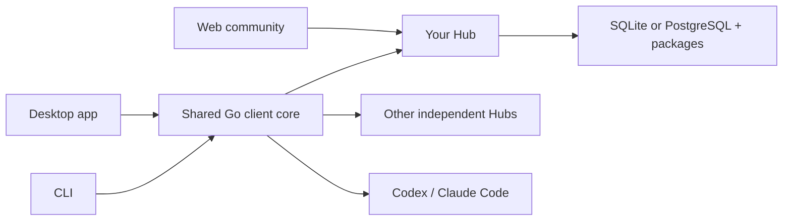

<p align="center">
  <picture>
    <source media="(prefers-color-scheme: dark)" srcset="desktop/frontend/public/assets/brand/logo-white.svg">
    
  </picture>
</p>

<h3 align="center">Your skills. Your community.</h3>
<p align="center">A self-hosted home for discovering, sharing and reviewing agent skills.<br>Bring them to Codex and Claude Code with the desktop app or CLI.</p>

<p align="center">
  <a href="https://github.com/skillhubhq/skillhub/actions/workflows/ci.yml"></a>
  <a href="LICENSE"></a>
  <a href="docs/configuration.md"></a>
</p>

<p align="center">
  <a href="#get-started">Get started</a> ·
  <a href="#self-host">Self-host</a> ·
  <a href="docs/README.md">Documentation</a> ·
  <a href="https://github.com/skillhubhq/skillhub/releases">Downloads</a> ·
  <a href="README.zh-CN.md">简体中文</a>
</p>

---

## A shared home for useful skills

| Discover | Share | Use |
| --- | --- | --- |
| Browse skills, authors and team pages. | Submit a version and receive independent review. | Install into a project or your global tool directory. |
| Search your connected Hubs with separate identities. | Organize access with namespaces, groups and roles. | Preview changes and protect local edits. |
| Read discussions and save useful versions. | Keep your community on your own infrastructure. | Pin exact versions and restore project skills. |

SkillHub manages skill files. It does not run agents, call models or execute package scripts.

## Get started

**Desktop:** add your Hub in **Settings → Connections**, sign in, and choose a skill. Select Codex or Claude Code, choose a destination, then review the changes before installing.

**CLI:** connect once, then discover and install from your terminal:

```sh
skillhub source add work https://skills.example.com
skillhub login work
skillhub search review --source work

# Replace the coordinate with a published version from your Hub.
skillhub install work/team/review@1.0.0 --tool codex --dry-run
skillhub install work/team/review@1.0.0 --tool codex --yes
```

Create a skill with `skillhub init ./my-skill --description "When to use this skill"`, refine it in your coding agent, and run `skillhub validate ./my-skill` before publishing. [Authoring guide](docs/authoring.md)

App and CLI share connections, saved credentials and installation records. Each Hub keeps its own accounts and permissions. Use `skillhub --help` to explore commands, or `--json` for scripts. [CLI guide →](docs/usage.md)

## Self-host

The Hub runs as **one Go process with an embedded Web UI**. Use SQLite for a simple local setup or PostgreSQL with a configured driver. Packages live in a local data directory; no Redis, queue or client daemon is required.

From a source checkout, install the Go version in [`go.mod`](go.mod) and Node 24, then:

```sh
make web
go build -o bin/skillhub-server ./cmd/skillhub-server
go build -o bin/skillhub ./cmd/skillhub

# Supply a 12–72-byte administrator password on stdin, then EOF.
bin/skillhub-server init --data .local/hub --admin admin --password-stdin
bin/skillhub-server serve --data .local/hub
```

Open **http://127.0.0.1:8080** and sign in. The Hub is private by default, with no public self-registration. Authorized administrators provision local accounts; enterprise OIDC sign-in can require approval before granting access.

For a server deployment, prepare HTTPS, durable storage and backups. Validate the configuration before starting:

```sh
skillhub-server check-config --config /etc/skillhub/hub.yaml
skillhub-server serve --config /etc/skillhub/hub.yaml
```

[Configuration](docs/configuration.md) · [Microsoft Entra ID](docs/enterprise-login.md) · [SQLite / PostgreSQL](docs/database.md) · [Deployment checklist](docs/deployment-checklist.md)

## How it fits together



Web provides the community, publishing and review experience for one Hub. App and CLI connect to multiple Hubs and manage local files through the same Go core. [Architecture →](docs/architecture.md)

## Downloads

[GitHub Releases](https://github.com/skillhubhq/skillhub/releases) is the distribution channel. When a build is available, choose the matching platform and verify its `SHA256SUMS`. If no release is available, use the source build above.

| Component | Packaged platforms |
| --- | --- |
| Desktop app | macOS Apple silicon · Windows x64 |
| Hub and CLI | Linux x64 · macOS Apple silicon · Windows x64 |

macOS requires 13 or later; Windows App requires WebView2. The macOS DMG is ad-hoc signed, without Developer ID signing or notarization; Windows builds are unsigned. App can check for updates and open the download page; installation is manual. Linux App packages are not provided. [Installation and verification →](docs/distribution.md)

## Documentation

Start with the [documentation index](docs/README.md), or go directly to:

- **Use:** [CLI workflows](docs/usage.md) · [Desktop app](desktop/README.md) · [App updates](docs/client-updates.md)
- **Operate:** [Identity and permissions](docs/identity-and-access.md) · [Review and security scans](docs/governance.md) · [Backup and recovery](docs/operations.md)
- **Build:** [Architecture](docs/architecture.md) · [TypeScript SDK](sdk/typescript/README.md) · [Testing](docs/testing.md)

## Contributing

Bug reports, documentation improvements and focused pull requests are welcome. Read the [contribution guide](CONTRIBUTING.md) for setup and checks. Use [private security reporting](SECURITY.md) for vulnerabilities.

```sh
make check       # Protocol, Go race tests and SDK checks; requires Buf
make quality     # Source hygiene, documentation links and packaging checks
make desktop     # Native app build on a supported host
```

## License

[Apache-2.0](LICENSE). See [NOTICE](NOTICE) and [third-party licenses](THIRD_PARTY_NOTICES.md). Skills hosted on a Hub have their own ownership and licensing; the software license does not grant rights to those packages.
