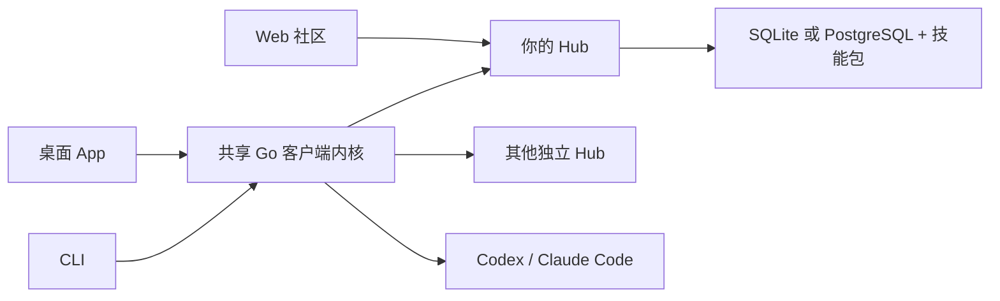

<p align="center">
  <picture>
    <source media="(prefers-color-scheme: dark)" srcset="desktop/frontend/public/assets/brand/logo-white.svg">
    
  </picture>
</p>

<h3 align="center">团队的技能，共同的社区。</h3>
<p align="center">自托管的技能社区，让好方法被发现、分享和审核。<br>通过桌面 App 或 CLI，把技能安装到 Codex 和 Claude Code。</p>

<p align="center">
  <a href="https://github.com/skillhubhq/skillhub/actions/workflows/ci.yml"></a>
  <a href="LICENSE"></a>
  <a href="docs/configuration.md"></a>
</p>

<p align="center">
  <a href="#开始使用">开始使用</a> ·
  <a href="#自行部署">自行部署</a> ·
  <a href="docs/README.md">文档</a> ·
  <a href="https://github.com/skillhubhq/skillhub/releases">下载</a> ·
  <a href="README.md">English</a>
</p>

---

## 让有用的技能汇聚在一起

| 发现 | 分享 | 使用 |
| --- | --- | --- |
| 浏览技能、作者和团队主页。 | 提交版本，获得独立审核与反馈。 | 安装到项目或工具的全局目录。 |
| 搜索多个 Hub，各自保留独立身份。 | 用命名空间、分组和角色组织权限。 | 安装前预览变更，保护本地修改。 |
| 参与讨论，收藏有用的版本。 | 将社区和内部内容保留在自己的基础设施上。 | 锁定准确版本，恢复项目技能。 |

SkillHub 管理技能文件，不运行 Agent、不调用模型，也不执行技能包内的脚本。

## 开始使用

**桌面 App：** 在「设置 → 连接与账号」中添加 Hub 并登录，找到需要的技能。选择 Codex 或 Claude Code、安装位置，再确认变更。

**CLI：** 添加一次连接，即可从终端搜索和安装：

```sh
skillhub source add work https://skills.example.com
skillhub login work
skillhub search review --source work

# 将下面的坐标替换为 Hub 中实际发布的技能版本。
skillhub install work/team/review@1.0.0 --tool codex --dry-run
skillhub install work/team/review@1.0.0 --tool codex --yes
```

App 与 CLI 共用连接、已保存凭据和安装记录。每个 Hub 独立管理账号与权限。使用 `skillhub --help` 查看命令，脚本调用可加 `--json`。[CLI 使用指南 →](docs/usage.md)

## 自行部署

Hub 是**内置 Web UI 的单个 Go 进程**。简单部署可使用 SQLite，也可以配置 PostgreSQL 驱动。技能包保存在本地数据目录，无需 Redis、队列或客户端守护进程。

在源码目录中安装 [`go.mod`](go.mod) 指定的 Go 和 Node 24，然后执行：

```sh
make web
go build -o bin/skillhub-server ./cmd/skillhub-server
go build -o bin/skillhub ./cmd/skillhub

# 从标准输入提供 12–72 字节的管理员密码，输入完成后发送 EOF。
bin/skillhub-server init --data .local/hub --admin admin --password-stdin
bin/skillhub-server serve --data .local/hub
```

打开 **http://127.0.0.1:8080** 并登录。默认是私有 Hub，不开放公众自行注册。获授权的管理员创建本地账号；企业 OIDC 登录可要求先审批、再准入。

部署到服务器前，准备 HTTPS、持久化存储和备份，并验证配置：

```sh
skillhub-server check-config --config /etc/skillhub/hub.yaml
skillhub-server serve --config /etc/skillhub/hub.yaml
```

[配置参考](docs/configuration.md) · [微软 Entra ID](docs/enterprise-login.md) · [SQLite / PostgreSQL](docs/database.md) · [部署清单](docs/deployment-checklist.md)

## 各部分如何协作



Web 面向一个 Hub，提供社区浏览、发布与审核。App 和 CLI 可以连接多个 Hub，通过同一套 Go 内核管理本机文件。[架构说明 →](docs/architecture.md)

## 下载

[GitHub Releases](https://github.com/skillhubhq/skillhub/releases) 是安装包分发入口。有可用版本时，选择对应平台并校验 `SHA256SUMS`；没有可用发行版时，可以按上文从源码构建。

| 组件 | 打包平台 |
| --- | --- |
| 桌面 App | macOS Apple 芯片 · Windows x64 |
| Hub 和 CLI | Linux x64 · macOS Apple 芯片 · Windows x64 |

macOS 需要 13 及以上，Windows App 需要 WebView2。macOS DMG 使用临时签名，尚无 Developer ID 签名和公证；Windows 构建未签名。App 支持检查更新并打开下载页，安装由用户手动完成。暂不提供 Linux App 安装包。[安装与校验 →](docs/distribution.md)

## 文档

可以从[文档索引](docs/README.md)开始，也可以直接查看：

- **使用：** [CLI 工作流](docs/usage.md) · [桌面 App](desktop/README.md) · [App 更新](docs/client-updates.md)
- **运维：** [身份与权限](docs/identity-and-access.md) · [审核与安全扫描](docs/governance.md) · [备份恢复](docs/operations.md)
- **开发：** [架构](docs/architecture.md) · [TypeScript SDK](sdk/typescript/README.md) · [测试](docs/testing.md)

## 参与贡献

欢迎问题反馈、文档改进和范围明确的 Pull Request。环境配置和检查要求见[贡献指南](CONTRIBUTING.md)。安全漏洞请使用[私密报告渠道](SECURITY.md)。

```sh
make check       # 协议、Go race 和 SDK 检查；需要 Buf
make quality     # 源码卫生、文档链接和打包检查
make desktop     # 在支持的平台构建原生 App
```

## 许可证

采用 [Apache-2.0](LICENSE)，详见 [NOTICE](NOTICE) 和[第三方许可证](THIRD_PARTY_NOTICES.md)。Hub 内技能包有各自的所有权和许可证；软件许可证不自动授予这些技能包的使用权。
